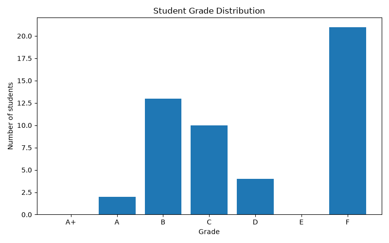
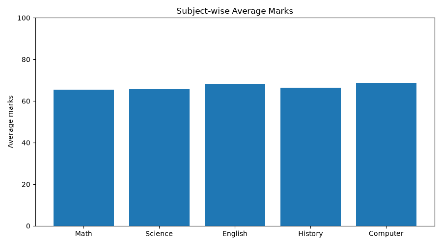

# Student Marks Analyzer

A beginner-friendly NumPy college project analyzing marks for **50 students in 5 subjects**.

## Setup (macOS / VS Code)

Open this folder in VS Code, then open **Terminal > New Terminal** and run:

```bash
python3 -m venv .venv
source .venv/bin/activate
python -m pip install -r requirements.txt
python main.py
python -m pytest -q
streamlit run app.py
```

Use **Python: Select Interpreter** in VS Code to choose `.venv/bin/python` if needed.

## Rules

- Subjects: Math, Science, English, History, Computer (stored using `np.array`).
- Marks: `np.random.randint(35, 100, (50, 5))`, which generates integers **35–99 inclusive**. Seed `42` makes runs reproducible.
- **Pass threshold: 40 per subject.** A mark **below 40** in *any* subject means the student fails overall. A mark of exactly 40 passes.
- Grade is based on the average, **unless the student fails any subject**, in which case the final grade is F.

| Grade | Average marks | Rule |
|---|---|---|
| A+ | 90–100 | All subjects passed |
| A | 80–<90 | All subjects passed |
| B | 70–<80 | All subjects passed |
| C | 60–<70 | All subjects passed |
| D | 50–<60 | All subjects passed |
| E | 40–<50 | All subjects passed |
| F | Any average | At least one subject below 40 |

Students with equal highest totals are all considered overall toppers. Subject-wise ties are also shown. The top 10 list uses total marks, breaking ties by original student ID order.

## Files

- `main.py` — terminal presentation, NumPy examples, top 10 report, CSV export.
- `app.py` — interactive Streamlit dashboard; runs separately from the terminal assignment.
- `analyzer.py` — generates data and performs all NumPy calculations.
- `visualizations.py` — creates PNG charts using Matplotlib.
- `requirements.txt` — required packages.
- `tests/test_analyzer.py` — automated checks for marks, totals, grades, failures and ties.
- `.gitignore` — excludes virtual environments, caches and generated outputs.

## Output

Running `python main.py` prints NumPy array properties, indexing and slicing demonstrations, Boolean masks, student and subject performance, failure IDs, grades and top 10 students. It creates:

- `output/student_results.csv`
- `output/subject_averages.png`
- `output/grade_distribution.png`

The `output/` directory is ignored by Git because these files can be regenerated.

## GitHub

Create an empty GitHub repository named `student-marks-analyzer` (without a generated README). Then in this folder:

```bash
git init
git add .
git commit -m "Build NumPy student marks analyzer"
git branch -M main
git remote add origin https://github.com/YOUR_USERNAME/student-marks-analyzer.git
git push -u origin main
```

Replace `YOUR_USERNAME` with your own GitHub username. GitHub hosts the source code; this command-line project does not require web deployment.

## Interactive dashboard

Install the project dependencies using the setup commands above, then launch the dashboard from the project folder:

```bash
streamlit run app.py
```

Streamlit opens the dashboard in your browser. It uses the existing NumPy analysis engine and the same fixed pass and grading rules as the command-line program. The dashboard includes class metrics, interactive charts, student ID search, grade filtering, subject analysis, and a CSV download of the currently visible results. It does not overwrite the CSV generated by `python main.py`.

To continue using the original assignment, run `python main.py` as before. The dashboard is a separate entry point.
  ## Results & Visualizations

### Student Grade Distribution

This chart shows the grade distribution of 50 students.



### Subject-wise Average Marks

This chart compares the average marks of students across five subjects.

